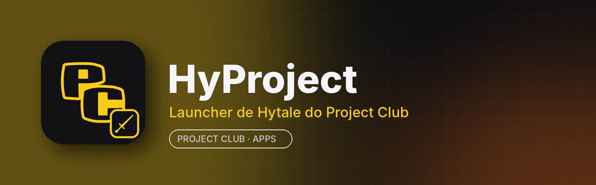

<p align="center"></p>

# HyProject

**HyProject** é o launcher de Hytale do **Project Club**: instale e atualize o jogo, organize perfis, gerencie mods e acompanhe as novidades, integrado à aba **Apps** do app para computador.

É baseado no **[HyPrism](https://github.com/hyprismteam/HyPrism)**, de código aberto sob a licença GNU GPL v3. Os recursos do HyPrism continuam aqui; o HyProject troca o nome e o ícone e faz a integração com o Project Club.

## Principais recursos

- Instala, atualiza e repara o jogo
- Vários perfis, cada um com seus mods e configurações
- Gerenciador de mods: busca, instala, atualiza e ativa/desativa
- Notícias e notas de atualização dentro do launcher
- Gerencia o Java usado pelo jogo
- Configurações de memória, resolução e argumentos de inicialização
- Interface em vários idiomas

## Instalar

Pelo **Project Club** (recomendado): aba **Apps → HyProject → Instalar**. As atualizações chegam por lá.

Manual: baixe em [Releases](../../releases/latest):
- **Windows 10/11 (64 bits):** `hyproject-<versão>-win.exe` (portátil, é só abrir)
- **Linux (x86_64):** `hyproject-<versão>-linux.AppImage` → `chmod +x *.AppImage && ./hyproject-*.AppImage`

## Requisitos

| | Mínimo | Recomendado |
|---|---|---|
| Sistema | Windows 10 64 bits / Linux x86_64 | Windows 11 / Ubuntu 22.04+ |
| CPU | 4 núcleos | 6 núcleos ou mais |
| RAM | 8 GB (o launcher usa ~200–400 MB; o jogo usa bem mais) | 16 GB |
| GPU | OpenGL 4.1 com 2 GB de VRAM | GPU dedicada com 4 GB+ |
| Disco | ~400 MB para o launcher + espaço do jogo | SSD |

## Compilar

.NET 10 SDK e Node.js 22 (veja [Docs/](Docs/) e [docs/README-HyPrism-original.md](docs/README-HyPrism-original.md)):

```bash
git clone https://github.com/RiqueBitt/HyProject
cd HyProject
dotnet build
dotnet run
```

Para gerar os pacotes publicados no Project Club, rode o workflow **Build HyProject release** (Actions → *Run workflow*, informando a versão). Ele compila Windows e Linux e publica a release `vX.Y.Z` **neste repositório**.

## Créditos e licença

HyProject é uma versão modificada do **HyPrism**, © hyprismteam e colaboradores, distribuída sob a **GNU General Public License v3** (veja [LICENSE](LICENSE) e as licenças de terceiros em [Licenses/](Licenses/)). O código-fonte completo, incluindo as modificações, está neste repositório. O HyProject não é afiliado ao HyPrism nem à Hypixel Studios; Hytale é marca da Hypixel Studios. O README original está em [docs/README-HyPrism-original.md](docs/README-HyPrism-original.md).
